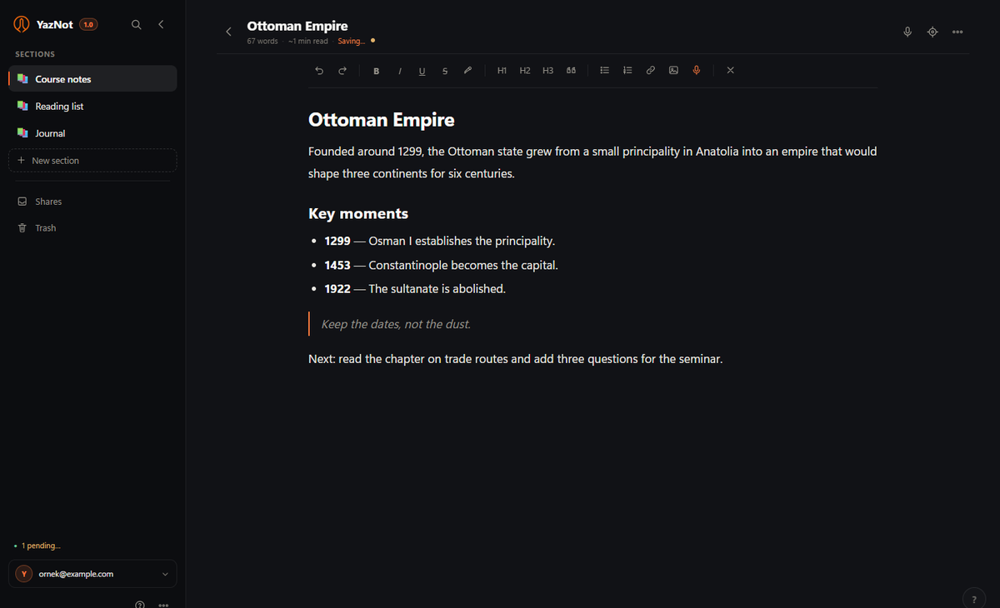

# YazNot

**English** · [Türkçe](README.tr.md)

A quiet, cloud-synced notebook for Windows and the web. The desktop app is
built with **Tauri 2** and **Rust**; the same interface ships as an installable
**PWA** for phones and browsers. The interface is Turkish and English.



YazNot keeps notes in **sections → groups → notes**, stores them locally first,
and syncs through a Supabase project that you own. Speech-to-text runs on the
device; audio never leaves the machine.

## Try it

- **Web app:** [yaznot.vercel.app/app](https://yaznot.vercel.app/app/)
- **Windows:** [YazNot-Setup-1.0.0.exe](https://yaznot.vercel.app/YazNot-Setup-1.0.0.exe) (4.4 MB)
- **Guide:** [PDF](https://yaznot.vercel.app/kilavuz-en.pdf) · the same guide is built into the app
- **Source:** [github.com/cankaracas/YazNot](https://github.com/cankaracas/YazNot)

## What it does

- **Write.** Sections, optional groups, emoji/colour accents, list or card
  layout, rich text, focus mode and a reader view.
- **Speak.** Turkish and English speech become text on the device with ONNX
  Runtime Web. The model is downloaded once and works offline.
- **Keep.** Offline-first IndexedDB storage, automatic retries, daily local
  backups (last 7 per account), JSON backup/restore, and PDF/TXT/Markdown
  exchange.
- **Find and recover.** Search all notes with `Ctrl+K`, move or delete in bulk,
  and restore anything from the 30-day trash.
- **Stay yours.** Multiple accounts per device, no telemetry, no analytics, and
  no third-party reader for your notes.

The Windows build also includes native PDF export and first-run migration from
an older local backup.

## Stack

```text
ui/                     one interface for desktop and web
 ├── app.js             sections, editor, search, sharing, trash
 ├── cloud-api.js       Supabase Auth/Storage + IndexedDB + retry queue
 ├── i18n.js            Turkish/English interface layer
 ├── stt/               on-device speech-to-text (Web Worker + WASM)
 └── platform.js        Tauri bridge; null in the browser

src-tauri/              Rust desktop shell
 ├── commands/          files, images, backups, PDF, Google sign-in
 ├── window_state.rs    window size, single-instance behaviour
 └── tauri.conf.json    CSP, bundle, identifier

web/                    PWA manifest, service worker, mobile styles
vercel/                 landing page and deployable site
scripts/                PWA, Vercel and guide generators
tests/                  jsdom UI, packaging, guide and STT tests
```

Native features are exposed through a small bridge. The same UI falls back to
browser APIs when the bridge is absent. See
[docs/ARCHITECTURE.md](docs/ARCHITECTURE.md) for the data model and bridge
contract.

## Requirements

- **Node.js 20+**
- **Rust 1.77+** with the MSVC toolchain on Windows
- **Visual Studio C++ build tools** on Windows
- **WebView2** on Windows 10/11 (preinstalled on current systems)

## Getting started

```bash
git clone https://github.com/cankaracas/YazNot.git
cd YazNot
npm ci
npm run setup       # creates ui/config.js and fetches runtime assets
```

Edit `ui/config.js` with your Supabase project URL and **publishable** key, then:

```bash
npm run dev         # Tauri development window
npm run build       # Windows NSIS installer
npm run build:vercel
```

`npm run setup` also runs before `dev`, `build`, `build:vercel` and `test`. It
copies `ui/config.example.js` to `ui/config.js` and copies ONNX Runtime Web
files from `node_modules` into `ui/stt/`.

### Supabase

1. Create a Supabase project.
2. Run the SQL in [docs/SUPABASE.md](docs/SUPABASE.md) to create `kv_store`
   and `shares` with row-level security.
3. Enable the sign-in providers you want (email OTP and/or Google).
4. Add the app URL to **Authentication → URL Configuration**.

Only the publishable key belongs in `ui/config.js`. Never commit
`ui/config.js`, a `service_role` key, or any other secret.

## Tests

```bash
npm test            # UI, accounts, packaging, PWA, guide and STT tests
npm run test:app    # optional: real STT model integration test
```

The optional model test needs the model files and `onnxruntime-web`; see
[docs/STT.md](docs/STT.md).

## Deployment

`npm run build:vercel` regenerates the static site in `vercel/`:

```text
vercel/
├── index.html, style.css, site.js   bilingual landing page
├── app/                             PWA
├── tanitim.mp4, tanitim-en.mp4      Turkish and English films
├── kilavuz.pdf, kilavuz-en.pdf      Turkish and English guides
└── YazNot-Setup-<version>.exe       Windows installer
```

The Vercel project uses `vercel/` as its root directory and deploys it as a
static site. The generated site files are tracked so a Git push publishes the
same build. After changing the domain, add it to Supabase's redirect URLs.

## Security and privacy

- Cloud data lives in the Supabase project you configure; row-level security
  keeps accounts isolated.
- Speech-to-text runs locally. Audio is never uploaded.
- The app has no telemetry or analytics.
- See [SECURITY.md](SECURITY.md) for vulnerability reporting and
  [docs/PRIVACY.md](docs/PRIVACY.md) for the data flow.

## Documentation

- [Architecture](docs/ARCHITECTURE.md)
- [Development and build](docs/DEVELOPMENT.md)
- [Supabase setup](docs/SUPABASE.md)
- [Privacy](docs/PRIVACY.md)
- [Speech-to-text](docs/STT.md)
- [User guide (English)](docs/USER-GUIDE.md)
- [Kullanım kılavuzu (Türkçe)](docs/USER-GUIDE.tr.md)
- [Roadmap](docs/ROADMAP.md)

## Acknowledgements

Speech-to-text uses [Duyu-small](https://huggingface.co/KaanAydinli/Duyu-small),
created by **Kaan Aydınlı** and released under Apache-2.0. The model is
downloaded at runtime and runs on the device. YazNot is independent and is not
affiliated with or endorsed by the model author.

Thanks to the Tauri, ONNX Runtime, PDF.js and Supabase maintainers, and to
everyone who publishes open-source code, models and documentation. See
[ACKNOWLEDGEMENTS.md](ACKNOWLEDGEMENTS.md) and
[THIRD_PARTY_NOTICES.md](THIRD_PARTY_NOTICES.md).

## Contributing

Bug reports, feature requests and pull requests are welcome. Read
[CONTRIBUTING.md](CONTRIBUTING.md) first.

## Licence

[MIT](LICENSE)
