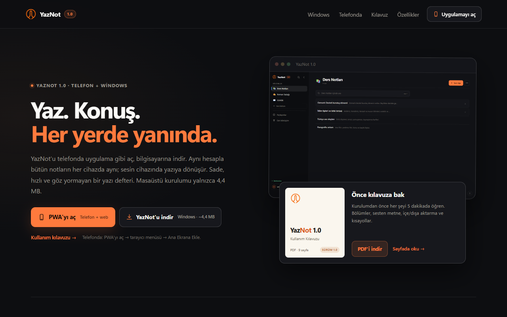
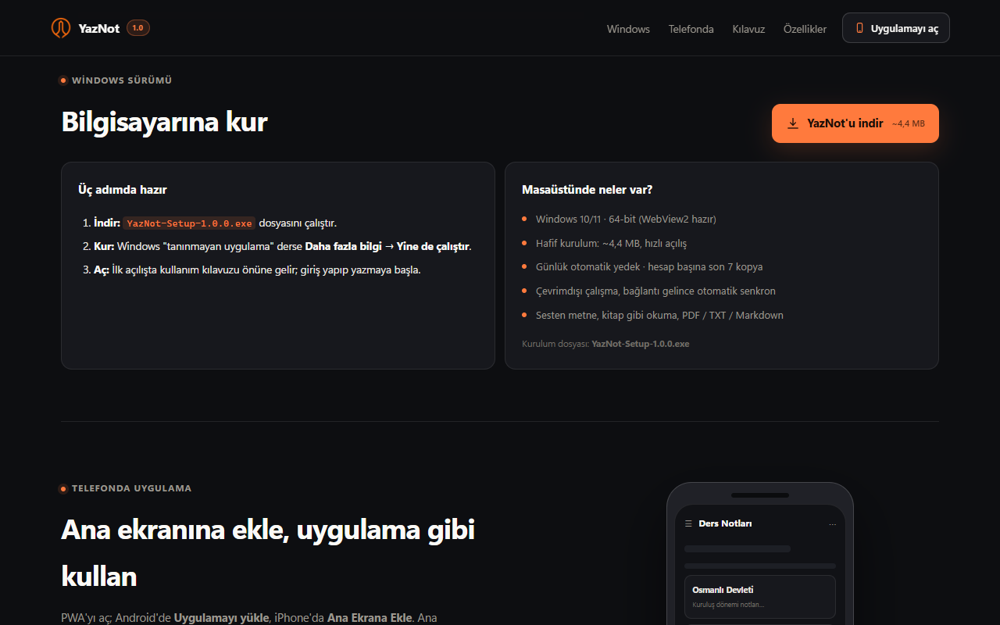
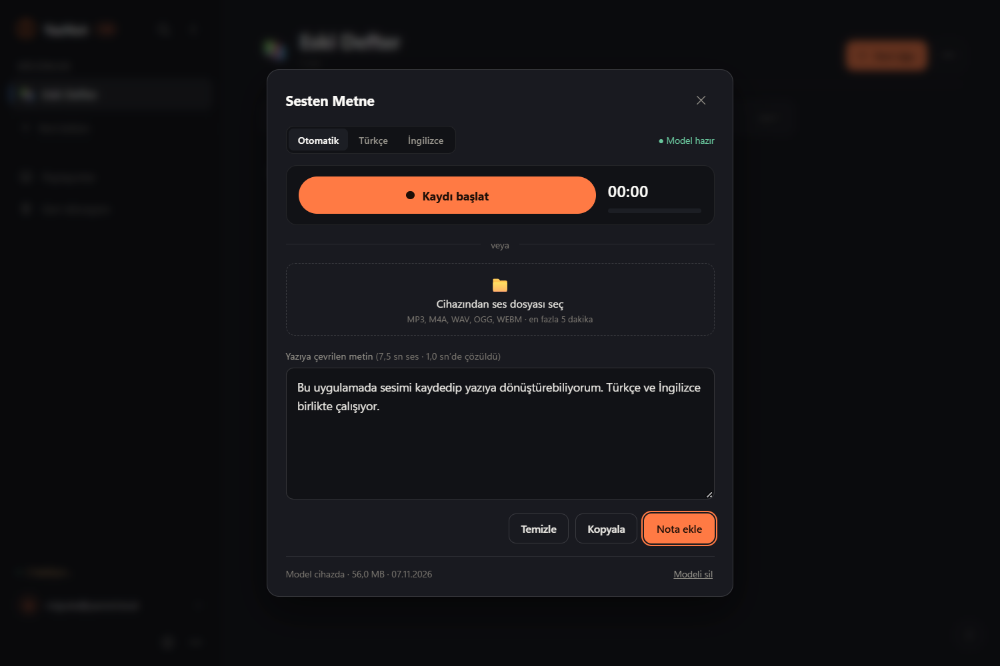

# YazNot

YazNot is a cloud-synced note-taking and writing app for Windows and the web.
The desktop app is built with **Tauri 2** and **Rust**; the same interface is
shipped as an installable **PWA** for phones and browsers.

Notes are organised as **sections → groups → notes**, stored locally first and
synchronised through a Supabase project that you own. Speech-to-text runs on the
device; audio never leaves the machine.

> The application interface is Turkish. This README is in English; a short
> Turkish overview is available in [README.tr.md](README.tr.md).

**Status:** Windows desktop and PWA are supported. macOS and Linux packaging is on the [roadmap](docs/ROADMAP.md).



## Features

- Sections, optional groups, emoji/colour/accent per section, list or card layout
- Rich-text editor with headings, bold/italic/underline, highlight, quotes, lists,
  links and inline images (automatic resize and compression)
- Instant search across all notes (`Ctrl+K`), reading mode with progress
- PDF, TXT and Markdown import/export; Markdown formatting is preserved
- On-device Turkish/English speech-to-text (ONNX Runtime Web, model downloaded once)
- Offline-first storage in IndexedDB; failed cloud writes are retried
- Multiple accounts on one device, each with its own local cache and session
- Trash with 30-day retention, undo toast, bulk move/delete/export
- Daily automatic local backups (last 7 per account) and JSON backup/restore
- Dark/light theme, focus mode, adjustable font, line height and editor width
- In-app user guide (opened on first login, available from the `?` button)

The Windows build also includes a native PDF export path and an optional
first-run migration from a previous local backup.

## Screenshots

| Windows download | Speech to text |
| --- | --- |
|  |  |

## Architecture

```
ui/                     single source of truth for the interface
 ├── cloud-api.js       Supabase + IndexedDB + offline sync
 ├── app.js             sections, editor, search, sharing
 ├── stt/               on-device speech-to-text (Web Worker + WASM)
 └── platform.js        native bridge (Tauri) or null in the browser

src-tauri/              Rust desktop shell
 ├── window + state     window size, single instance, memory policy
 ├── commands/          files, images, backups, PDF, Google sign-in
 └── tauri.conf.json    CSP, bundle, identifier

web/                    PWA-only additions (manifest, service worker, mobile CSS)
vercel/                 landing page source for a single deployable site
scripts/                PWA / Vercel / guide build scripts
tests/                  jsdom-based UI, packaging and STT tests
```

The same `ui/` directory is used by the desktop build and the PWA build. Native
features are exposed through a small JavaScript bridge; when the bridge is
absent, the UI falls back to browser APIs.

See [docs/ARCHITECTURE.md](docs/ARCHITECTURE.md) for the bridge contract and
data model, and [docs/DEVELOPMENT.md](docs/DEVELOPMENT.md) for the build
pipeline.

## Requirements

- **Node.js 20+**
- **Rust 1.77+** with the MSVC toolchain on Windows
- **Visual Studio C++ build tools** on Windows
- **WebView2** runtime on Windows 10/11 (preinstalled on current systems)

## Getting started

```bash
git clone <repository-url>
cd yaznot
npm ci
npm run setup     # creates ui/config.js and fetches runtime assets
```

Edit `ui/config.js` with your Supabase project URL and **publishable** key, then:

```bash
npm run dev       # desktop app in development mode
```

`npm run setup` is also run automatically before `dev`, `build`, `build:vercel`
and `test`. It copies `ui/config.example.js` to `ui/config.js` when the file is
missing and copies ONNX Runtime Web files from `node_modules` into `ui/stt/`.

### Supabase setup

1. Create a Supabase project.
2. Run the SQL in [docs/SUPABASE.md](docs/SUPABASE.md) to create the `kv_store`
   and `shares` tables with row-level security.
3. Enable the desired sign-in providers (email OTP and/or Google).
4. Add your deployment URL to **Authentication → URL Configuration**.

Only the publishable key belongs in `ui/config.js`. Never commit
`ui/config.js`, a `service_role` key, or any other secret.

## Building

```bash
npm run build            # Windows installer (NSIS)
npm run build:vercel     # regenerates the deployable vercel/ folder
```

The Windows artefacts are written to
`src-tauri/target/release/bundle/nsis/`.

For macOS and Linux, use the corresponding Tauri bundle target on that platform,
for example `npx tauri build --bundles dmg` or `--bundles appimage,deb`.
Cross-platform packaging is not yet part of the default release process.

### Publishing the web version

`npm run build:vercel` produces a single folder:

```
vercel/
├── index.html, style.css, ...   landing page
├── manifest.json, vercel.json
├── app/                         generated PWA
├── tanitim.mp4                  generated from docs/media/
├── tanitim-kapak.png            generated from docs/media/
├── kilavuz.pdf                  generated user guide
└── YazNot-Setup-<version>.exe   generated Windows installer
```

Upload the contents of `vercel/` to Vercel (or run `npx vercel --prod` from that
folder). After the domain is known, add it to Supabase's redirect URLs.
Generated files in `vercel/` are ignored by git.

## Tests

```bash
npm test          # UI, account, packaging, PWA, guide and STT tests
npm run test:app  # optional: real STT model integration test
```

The optional model test needs the model files and `onnxruntime-web`; see
[docs/STT.md](docs/STT.md).

## Project structure

| Path | Purpose |
|---|---|
| `ui/` | Application interface, shared by desktop and PWA |
| `src-tauri/` | Rust desktop shell and native commands |
| `web/` | PWA manifest, service worker and mobile styles |
| `vercel/` | Landing page source and deployment target |
| `scripts/` | PWA, Vercel and guide generators |
| `tests/` | Automated tests |
| `docs/` | Architecture, setup, privacy and user documentation |

## Security and privacy

- Cloud data lives in the Supabase project you configure; row-level security
  keeps each account isolated.
- Speech-to-text runs locally. Audio is never uploaded.
- The app has no telemetry or analytics.
- See [SECURITY.md](SECURITY.md) for vulnerability reporting and
  [docs/PRIVACY.md](docs/PRIVACY.md) for the data flow.

## Documentation

- [Architecture](docs/ARCHITECTURE.md)
- [Development and build](docs/DEVELOPMENT.md)
- [Supabase setup](docs/SUPABASE.md)
- [Privacy](docs/PRIVACY.md)
- [Speech-to-text](docs/STT.md)
- [User guide (Turkish)](docs/USER-GUIDE.tr.md)
- [Roadmap](docs/ROADMAP.md)
- [Acknowledgements](ACKNOWLEDGEMENTS.md)

## Acknowledgements

Speech-to-text is powered by [Duyu-small](https://huggingface.co/KaanAydinli/Duyu-small),
created by **Kaan Aydınlı** and released under the Apache-2.0 licence. The model
is downloaded at runtime and runs on the device. YazNot is independent and is
not affiliated with or endorsed by the model author.

Thanks to the maintainers of Tauri, ONNX Runtime, PDF.js and Supabase, and to
everyone who publishes open-source code, models and documentation. See
[ACKNOWLEDGEMENTS.md](ACKNOWLEDGEMENTS.md).

## Contributing

Bug reports, feature requests and pull requests are welcome. Please read
[CONTRIBUTING.md](CONTRIBUTING.md) before opening a pull request.

## Licence

[MIT](LICENSE)
