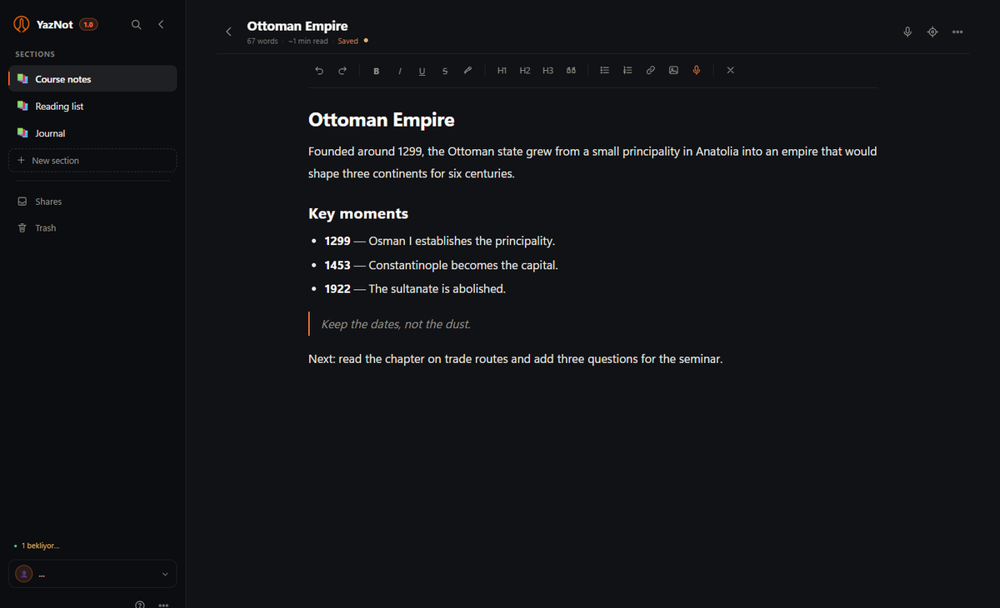

# YazNot

[English](README.md) · **Türkçe**

Windows ve web için sakin, bulut senkronlu bir not defteri. Masaüstü uygulaması
**Tauri 2** ve **Rust** ile yazıldı; aynı arayüz telefonda ve tarayıcıda
kurulabilen bir **PWA** olarak da çalışır.



YazNot notları **bölüm → grup → not** olarak tutar, önce cihazda saklar ve
senin sahip olduğun bir Supabase projesi üzerinden eşitler. Sesten metne
cihazda çalışır; ses kaydı makineden dışarı çıkmaz.

## Dene

- **Web uygulaması:** [yaznot.vercel.app/app](https://yaznot.vercel.app/app/)
- **Windows:** [YazNot-Setup-1.0.0.exe](https://yaznot.vercel.app/YazNot-Setup-1.0.0.exe) (4,4 MB)
- **Kılavuz:** [PDF](https://yaznot.vercel.app/kilavuz.pdf) · aynı kılavuz uygulamanın içinde de var
- **Kaynak:** [github.com/cankaracas/YazNot](https://github.com/cankaracas/YazNot)

## Neler yapar

- **Yaz.** Bölümler, isteğe bağlı gruplar, emoji/renk vurgusu, liste veya kart
  görünümü, zengin metin, odak modu ve kitap gibi okuma.
- **Konuş.** Türkçe ve İngilizce konuşma, ONNX Runtime Web ile cihazda yazıya
  dönüşür. Model bir kez indirilir, sonra çevrimdışı çalışır.
- **Sakla.** Önce cihazda IndexedDB, otomatik yeniden deneme, günlük yerel
  yedek (hesap başına son 7), JSON yedek/geri yükleme ve PDF/TXT/Markdown.
- **Bul ve geri al.** `Ctrl+K` ile tüm notlarda ara; toplu taşı veya sil;
  30 günlük geri dönüşüm kutusundan geri getir.
- **Senin kalsın.** Aynı cihazda birden fazla hesap; telemetri yok, analitik
  yok, notlarını okuyan üçüncü taraf yok.

Windows sürümünde ayrıca yerel PDF dışa aktarma ve eski yerel yedekten ilk
açılışta taşıma vardır.

## Yapı

```text
ui/                     masaüstü ve web için tek arayüz
 ├── app.js             bölümler, editör, arama, paylaşım, geri dönüşüm
 ├── cloud-api.js       Supabase Auth/Storage + IndexedDB + yeniden deneme
 ├── i18n.js            Türkçe/İngilizce arayüz katmanı
 ├── stt/               cihazda sesten metne (Web Worker + WASM)
 └── platform.js        Tauri köprüsü; tarayıcıda null

src-tauri/              Rust masaüstü kabuğu
 ├── commands/          dosya, görsel, yedek, PDF, Google girişi
 ├── window_state.rs    pencere boyutu, tek örnek davranışı
 └── tauri.conf.json    CSP, paket, kimlik

web/                    PWA manifest, service worker, mobil stiller
vercel/                 tanıtım sayfası ve yayınlanabilir site
scripts/                PWA, Vercel ve kılavuz üreticileri
tests/                  jsdom arayüz, paketleme, kılavuz ve STT testleri
```

Yerel özellikler küçük bir köprüyle açılır. Köprü yoksa aynı arayüz tarayıcı
API'lerine düşer. Veri modeli ve köprü sözleşmesi için
[docs/ARCHITECTURE.md](docs/ARCHITECTURE.md).

## Gereksinimler

- **Node.js 20+**
- Windows'ta **Rust 1.77+** ve MSVC araç zinciri
- Windows'ta **Visual Studio C++ derleme araçları**
- Windows 10/11'de **WebView2** (güncel sistemlerde hazır)

## Başlangıç

```bash
git clone https://github.com/cankaracas/YazNot.git
cd YazNot
npm ci
npm run setup       # ui/config.js ve çalışma dosyalarını hazırlar
```

`ui/config.js` içine Supabase proje adresini ve **publishable** anahtarı yaz;
sonra:

```bash
npm run dev         # Tauri geliştirme penceresi
npm run build       # Windows NSIS kurulumu
npm run build:vercel
```

`npm run setup`, `dev`, `build`, `build:vercel` ve `test` öncesinde kendiliğinden
çalışır. `ui/config.example.js` dosyasını `ui/config.js` olarak kopyalar ve ONNX
Runtime Web dosyalarını `node_modules` içinden `ui/stt/` klasörüne alır.

### Supabase

1. Bir Supabase projesi oluştur.
2. [docs/SUPABASE.md](docs/SUPABASE.md) içindeki SQL'i çalıştır: `kv_store` ve
   `shares` tabloları, satır düzeyi güvenlikle.
3. İstediğin giriş yöntemlerini aç (e-posta kodu ve/veya Google).
4. Uygulama adresini **Authentication → URL Configuration** bölümüne ekle.

`ui/config.js` içine yalnızca publishable anahtar girer. `ui/config.js`,
`service_role` anahtarı veya başka bir sır commit'lenmemeli.

## Testler

```bash
npm test            # arayüz, hesap, paketleme, PWA, kılavuz ve STT testleri
npm run test:app    # isteğe bağlı: gerçek STT modeli testi
```

İsteğe bağlı model testi için model dosyaları ve `onnxruntime-web` gerekir;
bkz. [docs/STT.md](docs/STT.md).

## Yayınlama

`npm run build:vercel`, `vercel/` altında statik siteyi yeniden üretir:

```text
vercel/
├── index.html, style.css, site.js   çift dilli tanıtım sayfası
├── app/                             PWA
├── tanitim.mp4, tanitim-en.mp4      Türkçe ve İngilizce filmler
├── kilavuz.pdf                      kullanım kılavuzu
└── YazNot-Setup-<sürüm>.exe         Windows kurulumu
```

Vercel projesi `vercel/` klasörünü kök dizin olarak kullanır ve statik site
olarak yayınlar. Üretilen site dosyaları takip edilir; böylece Git push aynı
sürümü yayınlar. Alan adını değiştirirsen Supabase yönlendirme adreslerine ekle.

## Güvenlik ve gizlilik

- Bulut verisi, senin yapılandırdığın Supabase projesinde durur; satır düzeyi
  güvenlik hesapları birbirinden ayırır.
- Sesten metne cihazda çalışır; ses yüklenmez.
- Uygulamada telemetri veya analitik yoktur.
- Açık bildirimi için [SECURITY.md](SECURITY.md), veri akışı için
  [docs/PRIVACY.md](docs/PRIVACY.md).

## Belgeler

- [Mimari](docs/ARCHITECTURE.md)
- [Geliştirme ve derleme](docs/DEVELOPMENT.md)
- [Supabase kurulumu](docs/SUPABASE.md)
- [Gizlilik](docs/PRIVACY.md)
- [Sesten metne](docs/STT.md)
- [Kullanım kılavuzu (Türkçe)](docs/USER-GUIDE.tr.md)
- [Yol haritası](docs/ROADMAP.md)

## Teşekkür

Sesten metne, **Kaan Aydınlı** tarafından Apache-2.0 lisansıyla yayınlanan
[Duyu-small](https://huggingface.co/KaanAydinli/Duyu-small) modelini kullanır.
Model çalışma anında indirilir ve cihazda çalışır. YazNot bağımsızdır; model
yazarıyla bağlantılı değildir veya onun tarafından onaylanmış değildir.

Tauri, ONNX Runtime, PDF.js ve Supabase bakıcılarına; kodunu, modelini ve
belgelerini açıkça paylaşan herkese teşekkürler. Bkz.
[ACKNOWLEDGEMENTS.md](ACKNOWLEDGEMENTS.md) ve
[THIRD_PARTY_NOTICES.md](THIRD_PARTY_NOTICES.md).

## Katkı

Hata bildirimi, özellik isteği ve pull request'ler açıktır. Önce
[CONTRIBUTING.md](CONTRIBUTING.md) dosyasını oku.

## Lisans

[MIT](LICENSE)
